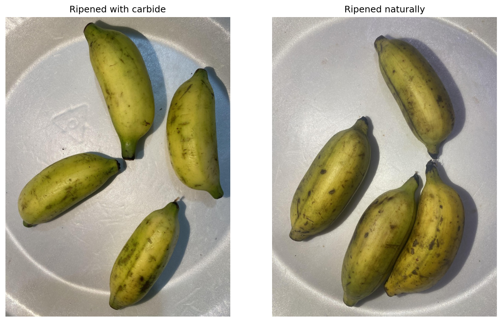
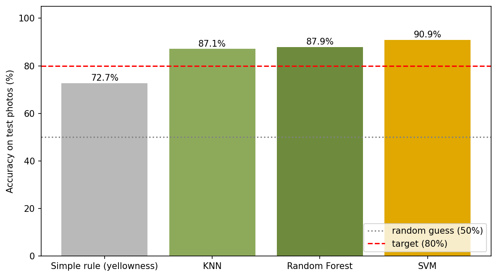
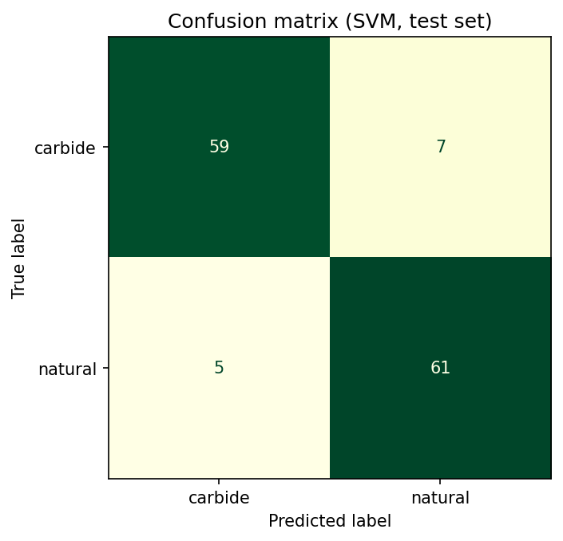
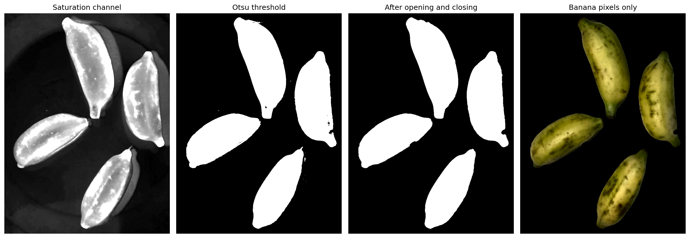
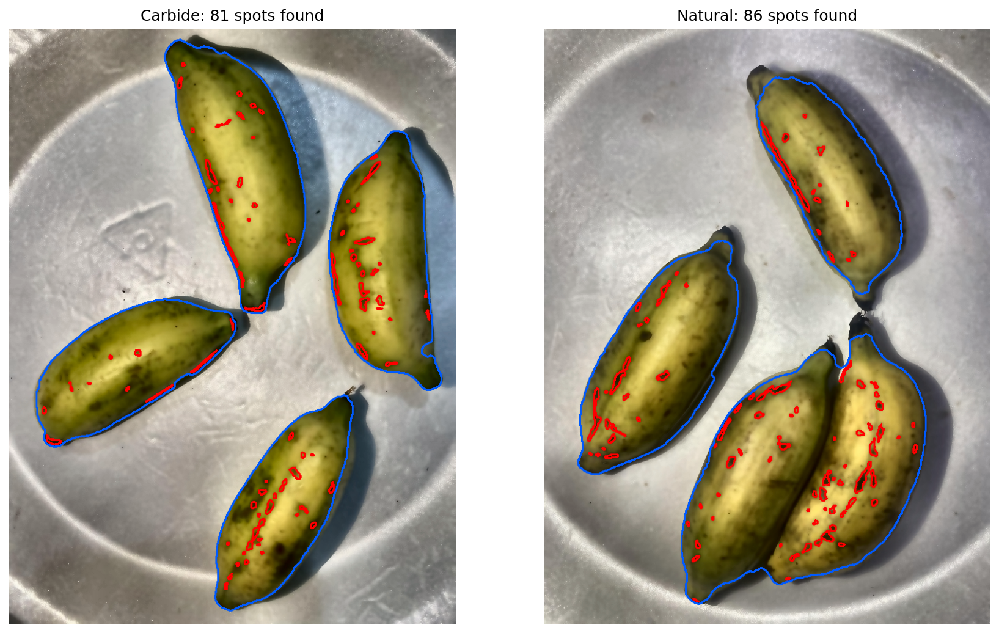
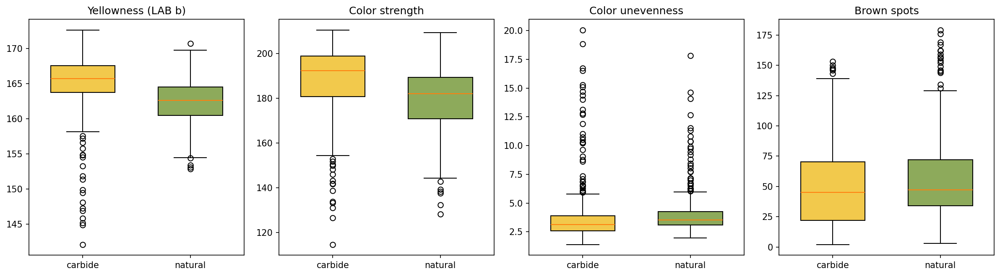
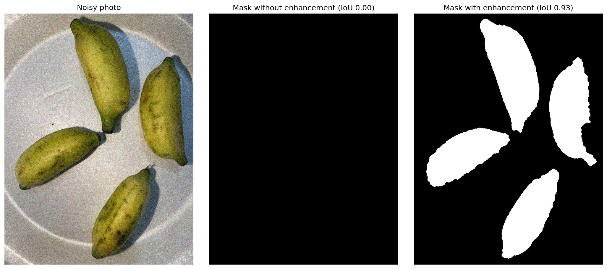

# Carbide Banana Detection

Can a normal phone photo tell if a banana was ripened naturally or with **calcium carbide**?

I built a classic image processing pipeline in OpenCV (no deep learning) that cuts the bananas out of the photo, measures their color, brown spots and skin texture, and classifies the photo as **carbide** or **natural**. The best model reaches **90.9% accuracy** on held out photos.



## Why this matters

Calcium carbide releases acetylene when it gets damp, which pushes green bananas to turn yellow in a day or two. Industrial grade carbide can carry arsenic and phosphorus traces, so it is banned for ripening fruit in India and Bangladesh. Lab tests work but they are slow and cost money. A photo based check could be a cheap first filter that tells an inspector which batch to send to the lab.

## Results

Balanced set of 656 photos (328 per class), 80/20 stratified split, `random_state=42`.

| Model | Test accuracy | 5 fold CV accuracy |
|---|---|---|
| Simple rule (LAB b > 165.1) | 72.7% | n/a |
| KNN (k = 5) | 87.1% | 83.4% |
| Random Forest (300 trees) | 87.9% | 86.0% |
| **SVM (RBF, C = 10)** | **90.9%** | **88.7%** |

Random guessing on this set gives 50%. On the 132 test photos the SVM missed 7 carbide photos and flagged 5 natural ones by mistake (precision 0.92 / recall 0.89 for carbide).

<p float="left">
  
  
</p>

For context, the dataset paper reports 80% with DenseNet201 and 72% with ResNet50. Their test setup is different (see the data section below), so this is not an apples to apples comparison.

## Pipeline

| Step | What I did | Settings |
|---|---|---|
| Load | Read JPEG, convert BGR to RGB | 756 x 1008 px, 3 channels |
| Represent | RGB to HSV and LAB | Saturation separates banana from plate |
| Enhance | Bilateral filter, then CLAHE on the L channel only | `d=9, sigmaColor=75, sigmaSpace=75`; `clipLimit=2.0, tileGridSize=(8,8)` |
| Segment | Otsu threshold on saturation, opening then closing, drop small blobs | 7x7 ellipse, open x2, close x3, keep regions > 1% of image |
| Count | Black hat to find dark spots inside the (eroded) banana mask | 15x15 ellipse, threshold 25, ignore blobs < 8 px, erode 9x9 |
| Describe | 13 features from banana pixels only | 10 color, 2 spot, 1 texture (Canny 50/150) |
| Classify | KNN, Random Forest, SVM | StandardScaler for KNN and SVM |

**Segmentation:** Otsu picked a threshold of 115 on the example photo.



**Spot counting:** the blue outline is the banana mask, red marks are detected spots.



**Features:** carbide bananas come out a bit more yellow (LAB b) and more saturated, natural ones have slightly more spots. The distributions overlap a lot, which is why one rule tops out at 72.7% and the classifiers that combine all 13 features do much better.



### Does enhancement actually help?

On the clean dataset photos, accuracy is about the same with or without it. The difference shows up on bad photos. I added Gaussian noise to 60 photos and compared the banana mask against the mask from the clean photo (IoU, 1.0 = perfect overlap):

| Noise (std) | Mask IoU without enhancement | Mask IoU with enhancement | Spots found (clean = 59) |
|---|---|---|---|
| 15 | 0.45 | 0.98 | 192 without, 80 with |
| 30 | 0.00 | 0.86 | 0 without, 134 with |

Without the bilateral filter and CLAHE, segmentation completely breaks at noise level 30.



## Data

[Ripen Banana Dataset](https://data.mendeley.com/datasets/j9sp322drp) by Alam et al. (2025), CC BY 4.0. Sabri bananas from Sirajganj, Bangladesh, photographed every 2 hours from Aug 26 to Sep 2, 2024 on a white plate with an iPhone 11 (3024 x 4032).

The download has 7,814 images, but only 1,404 are real photos. The rest are rotated, flipped, zoomed or noisy copies made for augmentation, and they are all mixed in the same folders. Training and testing on copies of the same photo would inflate accuracy, so I cleaned it first:

1. Dropped rotated copies (black corners from the rotation fill)
2. Compared 18 x 24 grayscale thumbnails of every photo against flipped and center zoomed versions of the others, grouped near matches and kept one per group
3. Dropped close up shots (banana area > 38% of the frame) so both classes are shot from a similar distance
4. Resized to 756 x 1008

That left **328 carbide** photos (the paper reports 311 originals, so this lines up) and **1,034 natural** ones. The kept files are listed in [`data/source_files.csv`](data/source_files.csv). The images are not in this repo because of their size.

## How to run

```bash
git clone https://github.com/elbochh/carbide-banana-detection.git
cd carbide-banana-detection
pip install -r requirements.txt
```

1. Download `With Carbide.zip` and `Without Carbide.zip` from the [Mendeley page](https://data.mendeley.com/datasets/j9sp322drp) (about 8.7 GB) and put them in `data/raw/`
2. `python prepare_data.py` (reads the zips directly, writes 1,362 images to `data/processed/`)
3. Open `carbide_banana_detection.ipynb` and run all cells. Feature extraction takes about 17 seconds for the 656 photos on a laptop.

Tested with Python 3.13, OpenCV 5.0, scikit-learn 1.7.

## Project structure

```
carbide-banana-detection/
├── carbide_banana_detection.ipynb   # full pipeline, plots and evaluation
├── prepare_data.py                  # builds data/processed from the Mendeley zips
├── data/
│   └── source_files.csv             # which original files were kept
├── images/                          # figures saved by the notebook
├── results/                         # model_results.csv, noise_test.csv
└── requirements.txt
```

## Limitations

* Small number of physical bananas, one variety, one location, one phone. It probably won't transfer to bananas from a different market without new data.
* Carbide and natural batches were shot in separate sessions, so some of the signal could be lighting or time of day rather than carbide itself.
* The carbide dose was not recorded.
* A photo only sees the skin. This can flag suspicious batches, it can't prove chemical treatment. A lab test still has the final word.
* Bananas that touch merge into one region, so the banana count can be low (3 instead of 4 on the natural example).

## What I'd try next

* Watershed segmentation to split touching bananas
* A CNN baseline (fine tuned ResNet or EfficientNet) on the same cleaned split
* Photos from local markets under real lighting

## References

* Alam, E., et al. (2025). Ripen banana dataset: A comprehensive resource for carbide detection and ripening stage analysis. *Data in Brief, 60*, 111659. https://doi.org/10.1016/j.dib.2025.111659
* Otsu, N. (1979). A threshold selection method from gray-level histograms. *IEEE Transactions on Systems, Man, and Cybernetics, 9*(1), 62-66. https://doi.org/10.1109/TSMC.1979.4310076
* Tomasi, C., & Manduchi, R. (1998). Bilateral filtering for gray and color images. *ICCV*, 839-846. https://doi.org/10.1109/ICCV.1998.710815
* Zuiderveld, K. (1994). Contrast limited adaptive histogram equalization. *Graphics Gems IV*, 474-485.
* Sai Vignesh, N., & Harini, S. (2024). Detection of artificially ripened bananas using multispectral images and deep learning. *ICSSEECC*, 50-55. https://doi.org/10.1109/ICSSEECC61126.2024.10649456

Originally built for ARTI 408 (Introduction to Computer Vision) at SAIT, Fall 2026.
